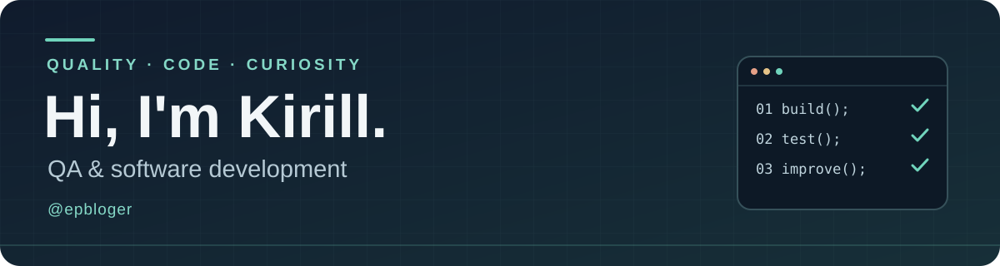

**Junior QA engineer · Software development · AI-assisted coding**

## About me

I'm Kirill. I build desktop tools, web apps and Unity games, study software testing and explore AI-assisted development.

📍 Saint Petersburg, Russia · Open to Junior QA opportunities.

## See my projects

<table>
<tr>
<td width="33%" valign="top">

<h3><a href="https://github.com/epbloger/zaberi">ЗАБЕРИ.</a></h3>
Android app for tracking orders, pickup deadlines, returns and expenses.

<code>Kotlin</code> <code>Jetpack Compose</code> <code>Room</code>

<a href="https://epbloger.github.io/zaberi/">Website ↗</a> · <a href="https://github.com/epbloger/zaberi/tree/release-1.0-dev">Source code ↗</a>

</td>
<td width="33%" valign="top">

<h3><a href="https://github.com/epbloger/trachu">ТРАЧУ.</a></h3>
Android app for tracking income, expenses, budgets and savings goals.

<code>Kotlin</code> <code>Jetpack Compose</code> <code>Room</code>

<a href="https://epbloger.github.io/trachu/">Website ↗</a> · <a href="https://github.com/epbloger/trachu">Source code ↗</a>

</td>
<td width="33%" valign="top">

<h3><a href="https://github.com/epbloger/shodi">SHODI / Сходи</a></h3>
City guide and route planner with offline support.

<code>JavaScript</code> <code>HTML</code> <code>CSS</code>

<a href="https://epbloger.github.io/shodi/">Live demo ↗</a> · <a href="https://github.com/epbloger/shodi/releases/latest">Download ↗</a>

</td>
</tr>
</table>

## Technologies & tools

**AI tools & agents**

---

[**Get in touch**](mailto:eplboger.commercial@gmail.com) · [**All repositories**](https://github.com/epbloger?tab=repositories)

