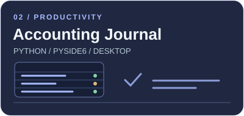

**Junior QA engineer · Python & C# · Web and game development**

## About me

I'm Kirill, an aspiring QA engineer who enjoys building software as much as testing it. I work on personal projects ranging from desktop utilities to browser applications and Unity prototypes.

- **Quality assurance:** studying software testing, SQL and test automation.
- **Development:** building practical tools with Python, C# and JavaScript.
- **Interests:** game mechanics, user-friendly interfaces, reliable releases and continuous improvement.
- **Career:** open to Junior QA opportunities.
- **Location:** Saint Petersburg, Russia.

## See my projects

### Featured projects

<table>
<tr>
<td width="33%" valign="top">

<h3><a href="https://github.com/epbloger/MoorkisDino2D">MoorkisDino2D</a></h3>
A 2D dinosaur runner prototype with sprite animation, jump physics and continuously scrolling backgrounds.

<code>C#</code> <code>Unity</code>

<a href="https://github.com/epbloger/MoorkisDino2D">Source code ↗</a>
 Game prototype · In development
</td>
<td width="33%" valign="top">

<h3><a href="https://github.com/epbloger/AccountingJournalPy">Accounting Journal</a></h3>
A desktop ticket tracker with status management, local storage, light/dark themes and backup &amp; restore.

<code>Python</code> <code>PySide6</code>

<a href="https://github.com/epbloger/AccountingJournalPy">Source code ↗</a> · <a href="https://github.com/epbloger/AccountingJournalPy/releases/latest">Download ↗</a>
 Windows installer available
</td>
<td width="33%" valign="top">

<h3><a href="https://github.com/epbloger/shodi">SHODI / Сходи</a></h3>
A city guide for Russia with searchable places, personal routes, visit tracking and offline HTML support.

<code>JavaScript</code> <code>HTML</code> <code>CSS</code>

<a href="https://epbloger.github.io/shodi/">Live demo ↗</a> · <a href="https://github.com/epbloger/shodi/releases/latest">Download ↗</a>
 Web app · 1,100+ cities in search
</td>
</tr>
</table>

### More projects

<table>
<tr>
<td width="33%" valign="top">

<h3><a href="https://github.com/epbloger/PyCalculator">PyCalculator</a></h3>
A simple Python calculator with seven arithmetic operations.
</td>
<td width="33%" valign="top">

<h3><a href="https://github.com/epbloger/PyRPG">PyRPG</a></h3>
A random password generator with beginner-friendly code comments.
</td>
<td width="33%" valign="top">

<h3><a href="https://github.com/epbloger/PyPersonalAssistant">PyPersonalAssistant</a></h3>
A console assistant for recommendations, dates, numbers and word utilities.
</td>
</tr>
</table>

[**View all repositories →**](https://github.com/epbloger?tab=repositories)

## Technologies & tools

**Languages**

**Web, desktop & games**

**Version control, testing & delivery**

## Quality assurance

| Focus | What I work on |
| :--- | :--- |
| Manual testing | Exploring application behavior and checking user workflows |
| Test automation | Learning automated checks and browser-based testing |
| Data | Learning SQL and working with structured application data |
| Delivery | Version control, automated builds, releases and documentation |

My repositories reflect what I'm learning and building. I care about making projects easy to run, understand and test.

## GitHub activity

## Contact me

For Junior QA opportunities, feedback on my projects or collaboration:

---

Thanks for stopping by. Feel free to explore the code or leave feedback.

