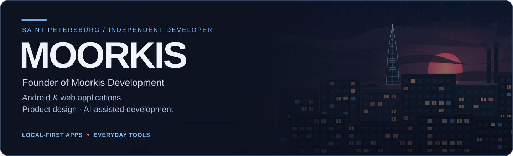
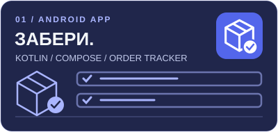

## About me

I'm **MOORKIS**, an independent developer and founder of [Moorkis Development](https://github.com/moorkis-development), based in Saint Petersburg, Russia.

I build practical Android and web applications for everyday life, from the initial concept and interface to implementation, distribution and ongoing improvements. My current projects help people manage purchases, keep track of their finances and discover places to visit.

I focus on clear interfaces, local-first data storage and useful features that work without mandatory accounts. I use AI-assisted development to prototype ideas and build complete products.

## Current projects

<table>
<tr>
<td width="33%" valign="top">

<h3><a href="https://github.com/epbloger/zaberi">ЗАБЕРИ.</a></h3>

<b>Purchase &amp; order management</b>

Track orders, pickup and return deadlines, refunds, and actual spending across stores.

<code>Kotlin</code> <code>Compose</code> <code>Room</code>

<b>Available on Android</b>

<a href="https://www.rustore.ru/catalog/app/ru.epbloger.zaberi">RuStore ↗</a> · <a href="https://epbloger.github.io/zaberi/">Website ↗</a> · <a href="https://github.com/epbloger/zaberi">Repository ↗</a>
</td>
<td width="33%" valign="top">

<h3><a href="https://github.com/epbloger/trachu">ТРАЧУ.</a></h3>

<b>Personal finance</b>

Manage income, expenses, accounts, budgets, savings goals and debts, with on-device records and backups.

<code>Kotlin</code> <code>Compose</code> <code>Room</code>

<b>Android application</b>

<a href="https://epbloger.github.io/trachu/">Website ↗</a> · <a href="https://github.com/epbloger/trachu">Repository ↗</a>
</td>
<td width="33%" valign="top">

<h3><a href="https://github.com/epbloger/shodi">Сходи.</a></h3>

<b>City guide &amp; walk planner</b>

Discover places across Russia and create personal walking itineraries. The downloadable HTML edition works offline.

<code>JavaScript</code> <code>HTML</code> <code>CSS</code>

<b>Available on the web</b>

<a href="https://epbloger.github.io/shodi/">Open app ↗</a> · <a href="https://github.com/epbloger/shodi/releases/latest">Download ↗</a> · <a href="https://github.com/epbloger/shodi">Repository ↗</a>
</td>
</tr>
</table>

## Development stack

**Android:** Kotlin · Jetpack Compose · Material 3 · Room · Gradle

**Web:** JavaScript · HTML · CSS · Node.js · esbuild

**Infrastructure:** Git · GitHub · GitHub Actions · GitHub Pages · RuStore

**AI-assisted development:** ChatGPT · OpenAI Codex

## Moorkis Development

An independent app studio making everyday tasks easier through accessible, thoughtfully designed software.

[Explore the studio and its applications →](https://github.com/moorkis-development)

---

**MOORKIS** · Saint Petersburg, Russia

[Studio](https://github.com/moorkis-development) · [Repositories](https://github.com/epbloger?tab=repositories) · [Contact](mailto:helpmoorkis@yandex.ru)

